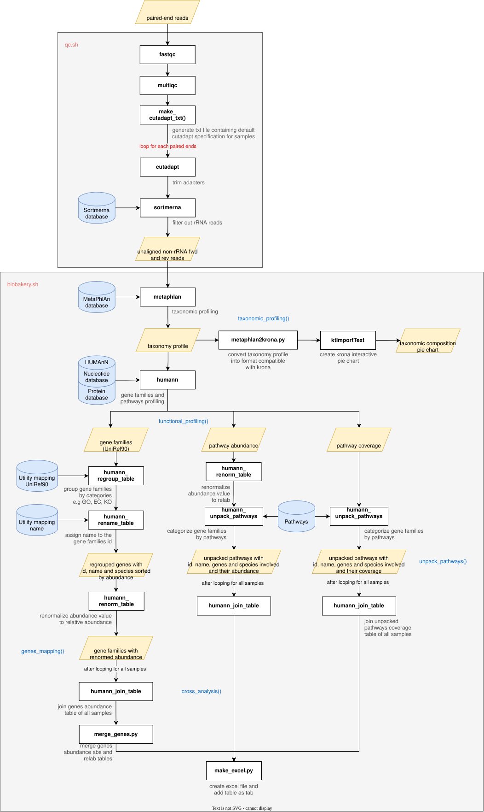

## Metagenomics Analysis Pipeline
<p align="center">
    
</p>

### Environments and Packages
(refer `qc.yml` and `biobakery.yml`)
1. **qc** — fastqc, multiqc, cutadapt
2. **biobakery** — metaphlan, krona, humann, pandas, openpyxl
```bash
    cd <ENV_PATH>
    conda create -n <QC_ENV_NAME> -c bioconda -c conda-forge fastqc multiqc cutadapt sortmerna
    conda create -n <BIOBAKERY_ENV_NAME> -c conda-forge -c bioconda -c biobakery -c defaults python=3.10 metaphlan krona humann=3.9 pandas openpyxl
```

### Database
1. **MetapPhlAn database**
    contains ChocoPhlAn SGB (Species-level Genome Bins) marker database
```bash
    conda activate <BIOBAKERY_ENV>
    metaphlan --install --index mpa_vJun23_CHOCOPhlAnSGB_202307
```
2. **HUMAnN database**   [[The Huttenhower Lab]](https://huttenhower.sph.harvard.edu/humann/)
    includes ChocoPhlAn (nucleotide pangenome database), UniRef90 (database of clustered protein sequences), utility mapping (mapping of UniRef90 id to other classification systems)
```bash
    conda activate <BIOBAKERY_ENV>
    PATH=<ENV_PATH>/lib/python3.10/site-packages/humann/data
    humann_databases --download chocophlan full $PATH --update-config yes
    humann_databases --download uniref uniref90_diamond $PATH --update-config yes
    humann_databases --download utility_mapping full $PATH --update-config yes
```

### Guide to Run the Pipeline
0. Set output and databases directories path in `lib.sh` and locate all paired-end reads at output directory
1. **Run QC** `fastqc` and `multiqc` on all paired-end reads
```bash
    conda activate <QC_ENV>
    bash qc.sh all          # run all unfinished steps, OR
    bash qc.sh allforce     # run all steps regardlessly
```
2. **Edit `cutadapt.txt`**
    - detected reads pair(s), default flags and their values are written to the `cutadapt.txt`
    - any missing paired-end reads, please add sample_name, r1 and r2 manualy in a new row
    - based on multiqc report, specifies trimming parameter for each reads pair by:
        - editing cutadapt flag on header row (`cutadapt --help` to refer all flags)
        - editing the values of each column (flag) and row (reads pair)
3. **Resume QC** in terminal [y/n], to perform `cutadapt`, pair by pair
```bash
    y
```
4. **Run bioBakery** taxonomic and functional profiling, pair by pair
```bash
    conda activate <BIOBAKERY_ENV>
    bash biobakery.sh all          # run all unfinished steps, OR
    bash biobakery.sh allforce     # run all steps regardlessly
```

### Sample Data
DNA Sequence from Monoculture Carrot Rhizosphere (SRR31030799)
DNA-Sequence from Soybean-precedent Carrot Rhizosphere (SRR30910742)

### Output Files Structure
```bash
metagenomics_biobakery
├── 0_Reads
│   └── (all raw paired-end reads)
├── 1_Fastqc
│   ├── <sample_1>_R1_fastqc.html
│   └── <sample_2>_R2_fastqc.html       
├── 2_Multiqc
│   ├── multiqc_report.pdf
│   └── multiqc_report_data
├── 3_Cutadapt
│   ├── <sample_1>_trimmed.fastq
│   ├── <sample_2>_trimmed.fastq
│   └── cutadapt.txt
├── 4_MetaPhlAn
│   ├── <sample_1>
│   │   └── <sample_1>.krona.html
│   └── <sample_2>
│       └── <sample_2>.krona.html
├── 5_HUMAnN
│   ├── <sample_1>
│   └── <sample_2>
├── 6_Genes_Mapping
│   ├── Genes_Abs
│   └── Genes_Relab
├── 7_Pathways_Analysis
│   ├── Unpacked_Pathabundance
│   └── Unpacked_Pathcoverage
├── 8_cross_analysis
│   ├── genes_uniref90.tsv
│   ├── genes_uniref50.tsv
│   ├── genes_eggnog.tsv
│   ├── genes_go.tsv
│   ├── genes_ko.tsv
│   ├── genes_level4ec.tsv
│   ├── genes_pfam.tsv
│   ├── unpacked_pathabundance.tsv
│   ├── unpacked_pathcoverage.tsv
│   └── genes_pathways.xlsx
└── logs
    └── pipeline_20261113_180933.log
```
